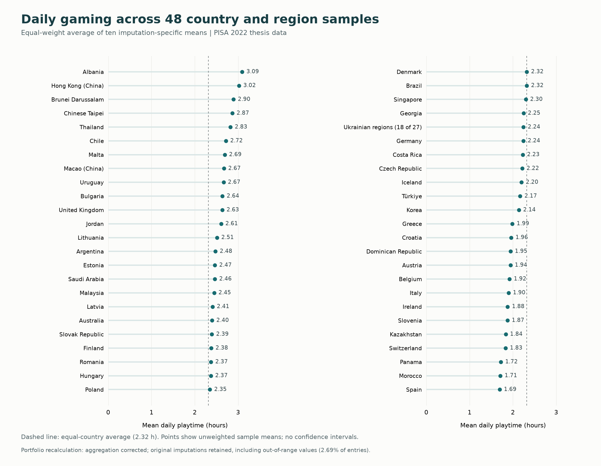

# Digital gaming and socio-emotional skills


**Tony Willert. Research case study based on my 2024 master's thesis at the University of Potsdam.**


## Project overview


How does daily gaming relate to adolescents' socio-emotional skills? For my master's thesis, I analysed PISA 2022 questionnaire data covering 370,972 student records across 48 countries and regions. I prepared the data in R, constructed measures, addressed missing values through multiple imputation, and compared country random-intercept models with and without background covariates. The thesis reported mostly small negative associations. This case study presents selected original findings alongside a corrected descriptive figure, documented code examples and explicit limits. It demonstrates my approach to connecting research questions, analytical decisions and careful interpretation.


## Research question and contribution


How is daily digital gaming associated with nine socio-emotional competencies, and what does an international perspective add?


The time displacement hypothesis provided the theoretical starting point: gaming may compete with activities supporting socio-emotional development. Yet gaming can itself involve social interaction. I therefore examined everyday playtime as a continuous measure, while recognising that duration alone cannot explain the experiences behind it. The study explored country differences without directly measuring cultural mechanisms.


I developed the research question, prepared the questionnaire data, constructed the gaming measure, reverse-coded items, and calculated scale scores and reliability statistics. Under academic supervision, I implemented the imputation and multilevel workflow, prepared results and interpreted their implications. The [selected R examples](R/) document these decisions. My portfolio revision separates original thesis estimates from later descriptive corrections.


## Data and methods


I used the [OECD PISA 2022 database](https://www.oecd.org/en/data/datasets/pisa-2022-database.html). The retained analysis data contain **370,972 records from 48 countries and regions in each of ten imputed datasets**. These are ten completed versions of one sample. Selection followed questionnaire coverage: countries without gaming information or without socio-emotional measurement altogether were excluded. The [country table](data/derived/countries.csv) lists IDs and sample sizes. Austria and Belgium lack observed emotional-control and trust scales; outcome coverage and exclusions mean the overall sample size is not a verified N for every regression.


**Measurement.** I combined weekday and weekend gaming responses into approximate daily hours, weighting them five and two times respectively. Response categories were assigned representative durations, including assumptions for the open upper category. Nine competencies were analysed separately: assertiveness, curiosity, emotional control, stress resistance, empathy, trust, cooperation, self-control and perseverance. Reversed items and mean scores made higher values consistently indicate more of each competency.


**Missing data.** Daily playtime was missing for 20.48% of retained records. I chose multiple imputation to retain information beyond complete cases and represent uncertainty about missing values. The thesis describes joint multilevel imputation using `jomo`/`mitml`, country clustering and auxiliary achievement and background variables. This approach depends on the missing-data assumptions and model specification; it does not guarantee unbiased estimates.


**Models.** Country random intercepts allow baseline competency levels to differ. Comparing unadjusted models with models including gender and HISEI, the highest parental occupational-status index, addresses background differences that could contribute to the apparent gaming association:


```r

unadjusted <- competency ~ dpt + (1 | cid)

adjusted   <- competency ~ dpt + hisei + gender + (1 | cid)

```


The thesis describes separate analyses across imputations and Rubin pooling. Standardised versions supported comparison of coefficient magnitudes. [Methods and code details](docs/methods.md) explain scoring, imputation, model specifications and the subsequent aggregation correction.


## Selected findings


### Original thesis results


These are **historically reported coefficients, not independently refitted estimates**. They come from Appendix A, Table 1 (PDF pages 47-48). B denotes the standardised daily-playtime coefficient; adjustment includes gender and HISEI. The [complete nine-outcome table](results/tables/thesis_coefficients.csv) preserves their source. No newly validated confidence intervals or significance claims are attached.


| Competency | Unadjusted B | Adjusted B |

|---|---:|---:|

| Self-control | -0.12 | -0.11 |

| Perseverance | -0.10 | -0.12 |

| Emotional control | -0.02 | -0.10 |

| Stress resistance | +0.06 | -0.03 |

| Empathy | -0.09 | -0.04 |


The reported associations were small. Adjustment strengthened the negative coefficients for perseverance and emotional control, but weakened self-control and empathy. Stress resistance changed sign. This comparison shows why the interpretation depends on both the competency and the covariates included.


### Descriptive context, recalculated for the portfolio





**Figure 1.** Unweighted sample means, giving each imputation equal weight. This corrects unequal weighting in the original plotting script. Points have no confidence intervals and are not population rankings. [Plotted values](results/tables/daily_playtime.csv) and [aggregate inputs](data/derived/dpt_country_by_imputation.csv) accompany the figure.


Corrected country means range from **1.69 hours in Spain to 3.09 hours in Albania**. Their equal-country average is **2.32 hours**; averaging over student records within each imputation gives **2.26 hours**. Different country sample sizes explain why these summaries differ. Neither is a survey-weighted worldwide estimate.


The figure retains the original imputations: **2.69% of playtime entries fall outside the coded 0-8-hour range**. The correction fixes aggregation, not imputation, and these values limit the plausibility of fine country comparisons.


## Interpretation and limits


The original results broadly followed the expected negative direction, but do not establish gaming time as a strong explanation of socio-emotional differences. They are compatible with time displacement without showing that displacement occurred. Two adolescents reporting identical playtime may differ in game content, motives and social experiences, none of which the duration measure captures.


Cross-sectional self-reports cannot establish causal direction. Country random intercepts accommodate different baselines but do not test country-specific gaming slopes or cultural explanations. The surviving models omit the full PISA survey design and school-level clustering. Scoring and exclusion-mask issues also need resolution before a new inferential analysis. [Limitations](docs/limitations.md) explains how these constraints affect the results shown here.


The next research steps follow from these limits: measure content, motives and social context; use repeated observations to investigate temporal ordering; and combine quantitative data with interviews or gaming diaries. Explicit contextual measures would be needed to test explanations involving norms or regulation. The present findings alone cannot justify playtime thresholds or recommendations for particular games.


## Reproducibility


I ran the original imputation on a university server. I did not copy the production code to my personal computer before routine server cleanup; I retained the methods description and imputed data. This repository therefore provides documented examples and a reproducible descriptive figure, not a full reproduction of the 2024 analysis. No new imputation or regression fitting was performed.


Figure regeneration instructions are in [methods](docs/methods.md#regenerating-the-descriptive-figure); [data provenance](data/README.md) identifies the source documents and aggregate files. Individual-level data and the unredacted thesis are not included.
